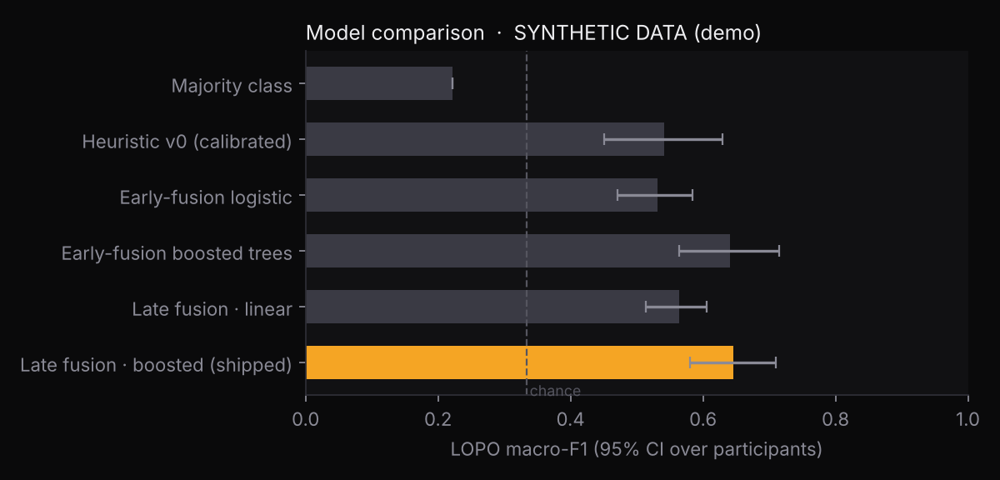
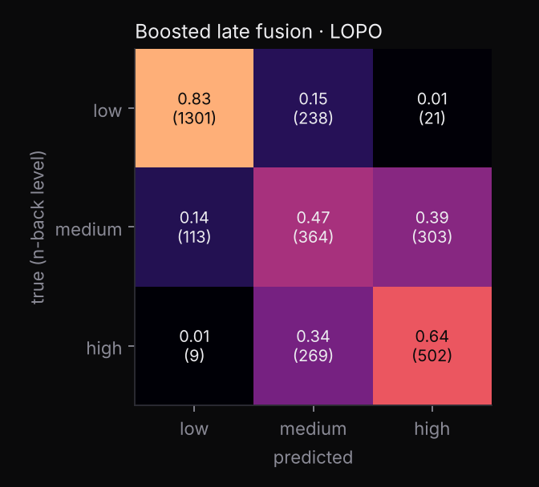
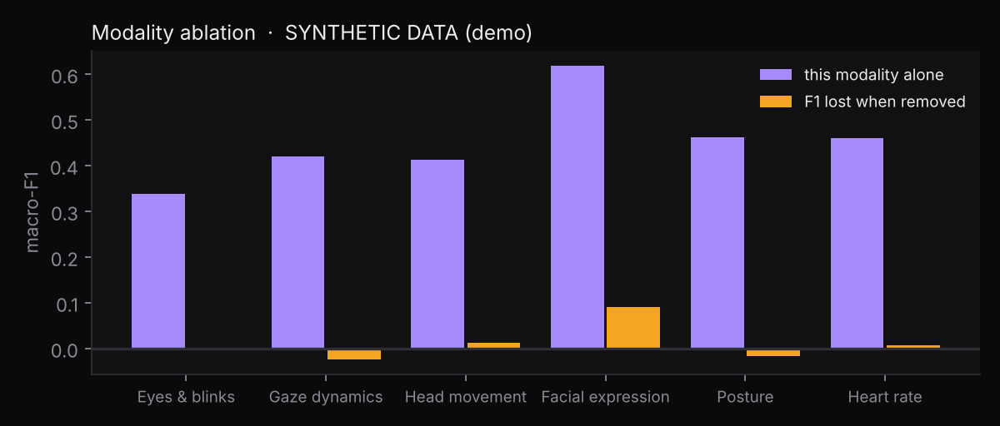

# Lucid · cognitive-load model report

> **⚠ SYNTHETIC DATA — pipeline demonstration only.** These numbers say nothing about real people.

- **Data:** 20 participants · 3,120 windows (10 s, hop 2 s) · sources: simulate(n=20, seed=1)
- **Target:** n-back load class — low (0/1-back), medium (2-back), high (3-back); features baseline-relative per person
- **Evaluation:** leave-one-participant-out — every number below is on people the model never saw

## Results

| Model | macro-F1 | 95% CI | balanced acc. | per-person F1 (mean ± sd) | ρ(load, TLX) |
|---|---|---|---|---|---|
| Majority class | 0.222 | 0.22–0.22 | 0.333 | 0.22 ± 0.00 | +nan |
| Heuristic v0 (calibrated) | 0.541 | 0.45–0.63 | 0.555 | 0.49 ± 0.24 | +0.55 |
| Early-fusion logistic | 0.532 | 0.47–0.58 | 0.531 | 0.48 ± 0.15 | +0.39 |
| Early-fusion boosted trees | 0.641 | 0.56–0.72 | 0.636 | 0.59 ± 0.20 | +0.62 |
| Late fusion · linear | 0.564 | 0.51–0.61 | 0.562 | 0.51 ± 0.12 | +0.50 |
| **Late fusion · boosted (shipped)** | 0.646 | 0.58–0.71 | 0.648 | 0.61 ± 0.18 | +0.70 |

Chance macro-F1 for 3 classes ≈ 0.33. ρ is Spearman correlation between the model's mean expected load per block and that block's NASA-TLX.

## Modality ablation

| Modality | alone | without it | Δ when removed | learned weight |
|---|---|---|---|---|
| Eyes & blinks | 0.337 | 0.648 | -0.002 | 0.13 |
| Gaze dynamics | 0.420 | 0.670 | -0.024 | 0.10 |
| Head movement | 0.412 | 0.635 | +0.012 | 0.18 |
| Facial expression | 0.619 | 0.556 | +0.090 | 0.25 |
| Posture | 0.461 | 0.663 | -0.017 | 0.10 |
| Heart rate | 0.461 | 0.639 | +0.007 | 0.24 |

## Why boosted late fusion ships

Each modality gets its own small boosted model, and a logistic meta-model weighs them. It is small enough to run in the browser, its per-modality contributions explain every prediction in the UI, and it degrades gracefully when a modality is missing (no body in frame, weak pulse). On the synthetic benchmark the purely linear late fusion did no better than the calibrated heuristic, which is why the per-modality learners are boosted. If early-fusion trees clearly beat it on real data, revisit the trade-off.

## Limitations

- n-back induces *working-memory* load in a controlled task; transfer to lectures is untested.
- Labels are block-level: every window in a block shares its n-back level, though moment-to-moment load varies.
- Small samples give wide confidence intervals — read the CI, not just the point estimate.
